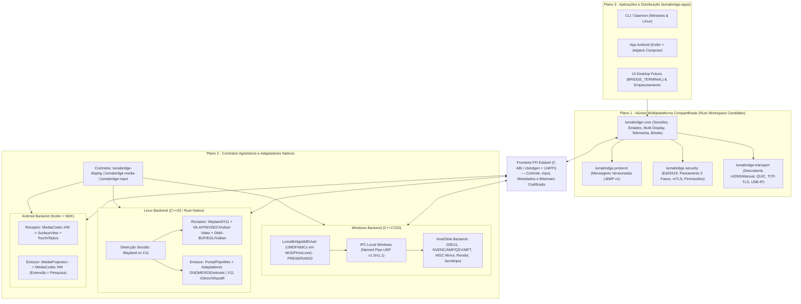

# Arquitetura da Plataforma Universal — LumaBridge Display

> **Nota de estado do repositório (`M0.4`):** Os módulos multiplataforma `core/`, `platforms/linux/` e `platforms/android/` descritos neste documento representam a **arquitetura proposta (`M1` ainda não iniciada)**. Em `origin/dev` (`0c3ddab`) reside apenas a base do driver virtual Windows (`M3`): **`M0` ainda não foi integrada em `dev` remoto**. As entregas Windows completas (`M4.1–M0.3`, incluindo extração D3D11, IPC local `LBIF` v1.0/v1.1, pool GPU compartilhado, codificação `NVENC H.264`, estímulo DXGI e validações reais aprovadas de `30 s` e `180 s` em `WUDFHost.exe` no commit funcional `6b297856`) e esta documentação universal foram consolidadas localmente na branch de integração `integration/m0-windows-closure`, aguardando publicação e merge em `origin/dev`.

---

## 1. Visão Sistêmica e Modelo de Nó Bidirecional

O LumaBridge Display abandona o modelo rígido `Host Windows → Cliente Linux` e passa a adotar o modelo simétrico de **Nó LumaBridge (`LumaBridge Node`)**.

Todo dispositivo que executa a plataforma anuncia suas capacidades reais descobertas em tempo de execução em quatro eixos independentes:

1. **`Display Sink` (Receptor de Vídeo):** recebe, decodifica e apresenta fluxos visuais de outros nós.
2. **`Mirror Source` (Emissor — Espelhamento):** captura um display físico ou janela/superfície existente respeitando o fluxo de autorização do sistema operacional.
3. **`Virtual Display Source` (Emissor — Extensão Real):** cria um monitor virtual reconhecido na **sessão gráfica ativa do usuário** com área de trabalho independente, resolução, taxa de atualização, escala DPI, orientação e posicionamento próprio.
4. **`Remote Input` (Captura / Injeção de Entrada):** envia ou injeta eventos de mouse, teclado, toque, rolagem e (futuramente) caneta digital, sujeito à permissão estritamente separada da visualização.

Um mesmo nó pode atuar apenas como receptor (ex.: tablet Android), apenas como emissor, ou em modo bidirecional simultâneo (ex.: PC Windows estendendo uma tela para um notebook Linux enquanto recebe outra tela ou espelhamento de volta), sempre limitado às capacidades comprovadas daquele SO, compositor gráfico, permissões e hardware.

### Restrições arquiteturais fundamentais

- **Receber vídeo ≠ criar monitor virtual:** a matriz de negociação anuncia separadamente `can_receive_video`, `can_mirror` e `can_extend_session`.
- **Múltiplas telas e múltiplos receptores previstos na fundação:** toda sessão possui `session_id` e todo fluxo de vídeo ou entrada referencia explicitamente um `display_id` e `display_geometry`, permitindo evoluir de 1 display para múltiplos displays/receptores sem refatoração do protocolo ou do núcleo.
- **Independência de UI e nuvem:** toda lógica de sessão, rede e mídia opera desacoplada de interface gráfica e sem qualquer dependência obrigatória de servidores externos.

---

## 2. Arquitetura Modular Proposta (9 Módulos em 3 Planos)

A separação sugerida de 9 módulos é organizada em **3 planos físicos e de dependência** para manter fronteiras acíclicas, evitar que texturas de GPU cruzem FFI e preservar integralmente o investimento C++/WDK existente:



> **Nota organizacional:** Os nomes dos 9 módulos definem fronteiras lógicas oficiais. Eles **não** implicam renomeação imediata de pastas Windows existentes (`windows/driver/` e `windows/host/`), cujo plano de convivência está detalhado em [MIGRATION_PLAN.md](../planning/MIGRATION_PLAN.md).

### 2.1 Tabela de Responsabilidades e Fronteiras dos 9 Módulos

| Módulo | Plano | Responsabilidade Principal | Pertence ao Módulo | Não Pertence ao Módulo |
|---|---|---|---|---|
| `lumabridge-protocol` | Plano 1 (Core) | Contratos e esquemas versionados entre plataformas (`LBWP v1`). | Serialização, envelopes, mensagens de pareamento/sessão/mídia/input, limites e validação sintática. | Sockets, TLS, codecs de vídeo, APIs gráficas, IPC local Windows `LBIF`. |
| `lumabridge-security` | Plano 1 (Core) | Identidade criptográfica, pareamento, confiança e autorização. | Chaves Ed25519, SPAKE2/QR + `tls-exporter`, Trust Store por SO, mTLS verifier, revogação, matriz `deny-by-default`. | Captura de tela, transporte de pacotes, UI de senha. |
| `lumabridge-transport` | Plano 1 (Core) | Descoberta e transporte independente de interface física. | mDNS/DNS-SD + IP manual, QUIC (RFC 9000/9221), fallback TCP/TLS 1.3, DPLPMTUD, fragmentação/pacing, túnel USB-IP/ADB, futuro NAT/ICE/relay. | Decisão de codec, manipulação de pixels, criação de monitor virtual. |
| `lumabridge-core` | Plano 1 (Core) | Orquestração do Nó, sessões e confiabilidade. | Máquinas de estado de nó/sessão, negociação de capacidades, controle de taxa adaptativo, política `gop_id`/`RequestForceIdr`, `ClockSync`, agregação p50/p95/p99. | D3D11, IddCx, Wayland, X11, MediaCodec, widgets de UI. |
| `lumabridge-display` | Plano 2 (Contratos) | Abstração de monitores virtuais, fontes de captura e apresentação. | Traits/interfaces `VirtualDisplayProvider`, `VideoSource`, `DisplayRenderer`, `DisplayMode`, geometria e metadados de exibição. | Implementação específica de IddCx, PipeWire, XRandR ou SurfaceView. |
| `lumabridge-media` | Plano 2 (Contratos) | Abstração de encode, decode, conversão e filas limitadas. | Interfaces `VideoEncoder`, `VideoDecoder`, `FrameDescriptor`, `VideoSurfaceHandle`, filas `drop-oldest` conscientes de GOP. | Rede QUIC/TCP, chamadas de driver kernel/UMDF. |
| `lumabridge-input` | Plano 2 (Contratos) | Normalização e contrato de entrada remota autorizada. | Mapeamento canônico USB HID scancodes, ponteiro/toque normalizado `[0..65535]` por `display_id`, rolagem, caneta, verificação de permissão ativa. | `SendInput`, `libei`, `XTest`, `AccessibilityService` concretos. |
| `lumabridge-platforms` | Plano 2 (Nativo) | Implementações concretas por sistema operacional e compositor. | Driver Windows `LumaBridgeIddDriver` (intocado), backend host/sink Windows, adaptadores Wayland/X11 Linux, backend NDK/Kotlin Android, futuro macOS/iOS. | Protocolo de fio `LBWP`, criptografia de pareamento, lógica global de sessão. |
| `lumabridge-apps` | Plano 3 (App) | Interfaces de usuário, configuração, serviços e instaladores. | CLI/daemon, app Android, futura GUI desktop (`BRIDGE_TERMINAL`), overlay de telemetria, empacotamento e instaladores. | Regras de protocolo, acesso direto ao driver sem mediação do backend/core. |

---

## 3. Integração Windows e Preservação do `LumaBridgeIddDriver`

A arquitetura preserva a fronteira limpa já desenhada no Windows entre o espaço de driver UMDF e o espaço do processo de aplicação do usuário:

1. **`LumaBridgeIddDriver.dll` (`WUDFHost.exe`, conta `LOCAL SERVICE`):**
   - Implementa exclusivamente o adaptador e monitor virtual via `WDF`/`IddCx` (`Adapter.*`, `VirtualMonitor.*`, `MonitorModes.*`, `SwapChainProcessor.*`), extração em GPU (`SharedTexturePool.*`, na branch M4.2/M4.2.1) e servidor Named Pipe endurecido (`FrameTransport.*`, `FrameIpcProtocol.h` `LBIF` v1.0/v1.1).
   - **Proibições permanentes no driver:** zero sockets ou bibliotecas de transporte remoto; zero dependência de NVIDIA Video Codec SDK (`nvEncodeAPI.h`), AMD AMF ou Intel oneVPL; zero pressuposição sobre qual sistema operacional receberá os quadros.
2. **Backend Windows (`windows/host` evoluído para `lumabridge-platforms/windows`):**
   - **Consumo de Extensão Virtual:** consome texturas compartilhadas D3D11 (`D3D11_RESOURCE_MISC_SHARED_NTHANDLE` + `IDXGIKeyedMutex`) do driver via IPC local `LBIF`, validando `AdapterLuid` e preservando `CpuStagingReadsPerformed == 0` no caminho normal.
   - **Captura de Espelhamento (Planejada):** módulo separado `WindowsMirrorSource` baseado em **Windows Graphics Capture (WGC)** (Windows 10 1903+) com fallback para **DXGI Desktop Duplication** (`IDXGIOutputDuplication`), entregando texturas `ID3D11Texture2D` ao mesmo pipeline `IVideoEncoder` sem precisar do driver IddCx quando apenas espelhamento for solicitado.
   - **Codificação Multi-Fabricante:** `NvencH264Encoder` passa a implementar `IVideoEncoder` ao lado de implementações futuras `AmfEncoder` (AMD), `OneVplQsvEncoder` (Intel) e `MediaFoundationHwEncoder` (fallback universal Windows para qualquer GPU WDDM com MFT de hardware).
   - **Receptor Windows (Planejado):** recebe pacotes via FFI de `lumabridge-core`, decodifica via `Media Foundation / D3D11VA` (ou `NVDEC`) e apresenta via `IDXGISwapChain1` em janela fullscreen/borderless com fila mínima.
   - **Input Remoto Windows (Planejado):** `SendInput` para mouse/teclado/toque normalizados somente após verificação de permissão na sessão e considerando limitações de UIPI/UAC.

---

## 4. Arquitetura de Vídeo Agnóstica de API Gráfica

Nenhuma plataforma fora do Windows deve conhecer `D3D11`, `DXGI_FORMAT` ou `LUID`.

### 4.1 Representação Agnóstica de Quadro (`FrameDescriptor` e `VideoSurfaceHandle`)

Todo quadro trafega internamente nos adaptadores nativos com uma descrição uniforme:

- **Identidade e geometria:** `display_id` (`u16`), `frame_id` (`u32`), `width`, `height`, `stride_bytes`, `orientation` (`0°|90°|180°|270°`), `scale_factor`.
- **Formato de pixel lógico:** `BGRA8`, `RGBA8`, `NV12`, `P010` (futuro HDR), `I420`.
- **Metadados de cor:** `ColorPrimaries` (`BT709`, `BT601`, `BT2020`), `TransferFunction`, `Range` (`Limited` vs `Full`).
- **Metadados temporais:** `capture_monotonic_ns` (relógio monotônico da fonte; no Windows derivado do timestamp causal pós-correção da M4.2.1), `encode_start_ns`, `encode_done_ns`.
- **Segurança:** `is_hw_protected` (se verdadeiro, quadro é descartado/substituído por sinal `PROTECTED_BLANK` sem expor pixels).
- **`VideoSurfaceHandle` (variante opaca nativa — nunca cruza FFI):**
  - `WinD3d11Texture { ID3D11Texture2D*, adapter_luid, keyed_mutex_or_fence }`
  - `LinuxDmaBuf { fd_planes[4], strides[4], offsets[4], drm_fourcc, drm_modifier, sync_fence_fd }`
  - `LinuxShmMemFd { fd_or_ptr, size }` *(fallback explícito CPU/XShm)*
  - `AndroidHardwareSurface { ANativeWindow* / AHardwareBuffer* }`
  - `CpuLinearBuffer { planes[], strides[] }` *(apenas diagnóstico ou fallback software explícito)*

### 4.2 Fluxo Zero-Copy, Ownership, Sincronização GPU e Backpressure

```mermaid
flowchart LR
    subgraph TX["Emissor Nativo (TX)"]
        CAP["Captura (IddCx / WGC / PipeWire / XShm / MediaProjection)"]
        POOL["Pool Limitado GPU (Zero-Copy Nativo ou Fallback SHM)"]
        PREP["Conversao GPU Cor/Escala (BGRA -> NV12)"]
        ENC["VideoEncoder Negociado (NVENC / AMF / QSV / MFT / VA-API / MediaCodec)"]
        FFI_TX["Fronteira FFI: Bitstream Codificado + gop_id + Timestamps"]
        CAP --> POOL --> PREP --> ENC --> FFI_TX
    end

    CORE_NET["lumabridge-core + lumabridge-transport (QUIC / TCP-TLS, Pacing, Supressao GOP Quebrado)"]

    subgraph RX["Receptor Nativo (RX)"]
        FFI_RX["Fronteira FFI: Quadro Remontado Integro ou AwaitingIdr"]
        DEC["VideoDecoder HW Negociado (VA-API / D3D11VA / MediaCodec / Vulkan Video)"]
        SURF["Superficie Nativa (DMA-BUF / D3D11 Texture / SurfaceView)"]
        PRES["Apresentacao Baixa Latencia (Mailbox 1-Slot + Overlay Opcional)"]
        FFI_RX --> DEC --> SURF --> PRES
    end

    FFI_TX --> CORE_NET --> FFI_RX
    CORE_NET -. "Feedback (Request-IDR, Bitrate Alvo, Perda, ClockSync)" .-> FFI_TX
```



#### Ownership e Sincronização por Plataforma

| Plataforma | Mecanismo Zero-Copy Primário | Sincronização de Memória | Fallback Explícito quando Zero-Copy Indisponível |
|---|---|---|---|
| **Windows (Extensão)** | `D3D11` Shared NT Handle entre `WUDFHost.exe` e backend host (`M4.2`) | `IDXGIKeyedMutex` (chaves `0 ↔ 1`) + `FrameIpcFrameAck` | IPC v1.0 `CpuStagingPipe` (cópia staging controlada apenas quando GPU shared falhar ou for desabilitado) |
| **Windows (Espelhamento / Receptor)** | Textura `ID3D11Texture2D` intra-processo direto para encoder/decoder/swapchain | Contexto imediato D3D11 / `ID3D11Fence` | Staging texture D3D11 apenas para fallback SW diagnóstico |
| **Linux (Wayland/PipeWire)** | `DMA-BUF` com negociação de `DRM format modifiers` (`SPA_DATA_DmaBuf`) até VA-API/Vulkan/Wayland (`zwp_linux_dmabuf_v1`) | `dma_buf` implicit sync ou `sync_file` explicit fencing (`SPA_META_SyncTimeline`) | `MemFd` / `XShm` + upload linear para GPU quando GPU híbrida não compartilhar modifier |
| **Android** | `VirtualDisplay` → `Surface` de entrada do `MediaCodec` (emissor); `MediaCodec` → `SurfaceView` (receptor) | `BufferQueue` / fences Gralloc gerenciados pelo Android | `ImageReader` / CPU YUV somente se necessário para diagnóstico |

#### Negociação de Codec e Independência de Hardware

- **Codec baseline obrigatório:** **H.264** (`Constrained Baseline` / `High` sem B-frames, Annex-B, `repeatSPSPPS=1`) para máxima interoperabilidade inicial entre Windows, Linux e Android.
- **Codecs opcionais negociados:** **HEVC (H.265)** (prioritário quando ambos têm HW encode/decode e resolução >= 1440p ou Wi-Fi restrito) e **AV1** (quando ambos têm HW encode/decode em geração compatível).
- **Ordem de seleção de backend de mídia (negociável, sem hardware obrigatório):**
  - *Windows Encoder:* `NVENC` → `AMD AMF` → `Intel oneVPL/QSV` → `Media Foundation HW MFT` → fallback software explícito (apenas se habilitado).
  - *Linux Encoder/Decoder:* `VA-API` (Intel/AMD Mesa) / `NVENC-NVDEC` (NVIDIA) / `Vulkan Video` / `V4L2` (SoCs ARM) → fallback software explícito (ex.: `OpenH264` / `dav1d` / `SVT-AV1`).
  - *Android:* `MediaCodec` hardware (`OMX`/`c2.*` não software) → fallback SW apenas diagnóstico.

#### Política de Backpressure em 4 Estágios (Zero Crescimento de Latência)

1. **Captura → Encode:** profundidade máxima `1–2` quadros no pool; o produtor gráfico nunca bloqueia DWM/compositor aguardando encoder.
2. **Encode → Rede:** fila limitada de pacotes codificados; se o socket/QUIC estiver congestionado e um P-frame expirar, aplica-se a regra da [ADR-0005](./ADR-0005-transport-and-security-architecture.md): marcar o `gop_id` como quebrado, suprimir a cauda P dependente e disparar `RequestForceIdr`.
3. **Rede → Decode:** janela máxima de remontagem de `<= 4` quadros; lacunas no mesmo `gop_id` colocam o receptor em `AwaitingIdr`, mantendo o último quadro íntegro exibido até o próximo IDR.
4. **Decode → Apresentação:** política *mailbox* de 1 slot (sempre apresentar o quadro decodificado mais recente no próximo VSync ou modo de baixa latência).

---

## 5. Arquitetura Adaptativa Linux (Wayland e X11)

O executável Linux detecta o servidor gráfico automaticamente em runtime inspecionando `XDG_SESSION_TYPE`, `WAYLAND_DISPLAY`, `DISPLAY` e `XDG_CURRENT_DESKTOP` (permitindo `--display-backend auto|wayland|x11` para diagnóstico), sem presumir que Wayland e X11 compartilhem a mesma API.

```text
Detecção em Runtime (XDG_SESSION_TYPE / WAYLAND_DISPLAY / DISPLAY)
 ├── Wayland Ativo
 │    ├── Receptor: Cliente Wayland nativo (Vulkan / EGL + zwp_linux_dmabuf_v1 + wp_viewporter + xdg_shell fullscreen)
 │    └── Emissor:
 │         ├── Espelhamento: org.freedesktop.portal.ScreenCast + PipeWire (com restore_token quando suportado)
 │         ├── Extensão Real: Camada IVirtualDisplayAdapter selecionada por compositor:
 │         │     ├── GNOME/Mutter  -> ScreenCast VIRTUAL / org.gnome.Mutter.ScreenCast (versão dependente)
 │         │     ├── KDE/KWin      -> Portal KDE / KWin Virtual Output (versão dependente)
 │         │     ├── Sway          -> IPC swaymsg create_output + PipeWire/wlr-screencopy
 │         │     ├── Hyprland      -> IPC hyprctl output create headless + PipeWire/hyprland-portal
 │         │     └── Outros        -> Degradação explícita para somente Espelhamento
 │         └── Input Remoto: org.freedesktop.portal.RemoteDesktop + libei/EIS (ou protocolos wlroots se expostos)
 └── X11 / X.Org Ativo
      ├── Receptor: Janela X11 nativa (xcb/Xlib + Vulkan/EGL/GLX + _NET_WM_STATE_FULLSCREEN)
      └── Emissor:
           ├── Espelhamento: XRandR (geometria) + XShmGetImage + XDamage + XFixes (cursor)
           ├── Extensão Real: Condicional (saída virtual pré-configurada / DRM-KMS VKMS; NUNCA Xvfb/Xdummy como extensão)
           └── Input Remoto: Extensão XTest na sessão ativa
```

---

## 6. Arquitetura Android

- **Estrutura:** aplicativo nativo Kotlin (Jetpack Compose para UI de pareamento, permissões, descoberta e diagnóstico; `SurfaceView` dedicada para apresentação de vídeo sem composição pesada) acoplado via `UniFFI` / NDK ao núcleo compartilhado.
- **Receptor (`M3`):** recebe stream por Wi-Fi/LAN ou enlace USB compatível, alimenta diretamente `MediaCodec` em modo hardware assíncrono ligado ao `Surface` da `SurfaceView` (`releaseOutputBuffer` no timestamp mais recente sem fila), transmite toque/rolagem/teclado/caneta somente quando autorizado na sessão e suporta reconexão controlada configurável.
- **Emissor (`M5`):** captura via `MediaProjection` + `VirtualDisplay` direcionado diretamente ao `InputSurface` de um `MediaCodec` encoder (respeitando Android 14+ *Foreground Service* e consentimento explícito por sessão).
- **Extensão Real no Android:** tratada estritamente como capacidade investigativa dependente de versão/OEM, conforme detalhado na [Matriz de Compatibilidade](./compatibility-matrix.md).

---

## 7. Direção Visual e Telemetria (`BRIDGE_TERMINAL`)

Toda interface gráfica futura, CLI e overlay de métricas no receptor devem seguir as diretrizes definidas em [DESIGN.md](../design/DESIGN.md):

- **Fidelidade visual absoluta do vídeo remoto:** o conteúdo do monitor estendido ou espelhado **nunca** recebe efeitos de scanline, tint, glitch ou bloom.
- **Overlay HUD opcional e desacoplado:** exibe métricas essenciais (`FPS`, `bitrate`, `codec/backend HW`, `RTT`, `jitter`, `drops`, `p50/p95/p99` quando disponível e status de permissão `VIEW` vs `INPUT_ACTIVE`) sem bloquear a thread de apresentação.
- **Privacidade:** telemetria estruturada em JSON/logs registra apenas contadores, estados e latências — jamais buffers de vídeo, capturas ou teclas digitadas.
